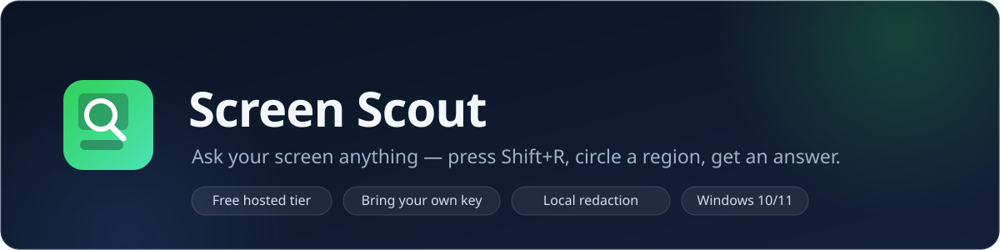
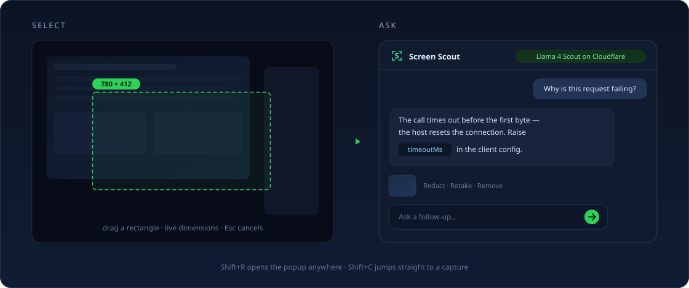
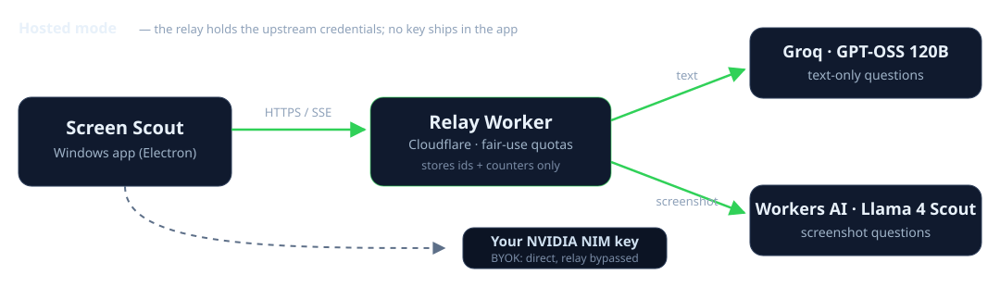

<div align="center">


# Screen Scout

[](https://github.com/flames-09/screen-scout/releases/latest)
[](https://github.com/flames-09/screen-scout/actions/workflows/ci.yml)
[](https://github.com/flames-09/screen-scout/stargazers)
[](https://github.com/flames-09/screen-scout/issues)
[](LICENSE)
[](#install)

<br>

[](https://github.com/flames-09/screen-scout/releases/latest)
[](https://github.com/flames-09/screen-scout/issues/new?template=bug.yml)
[](https://github.com/flames-09/screen-scout/issues/new?template=feature_request.yml)
[](https://github.com/flames-09/screen-scout/discussions)
[](https://github.com/flames-09/screen-scout/stargazers)

</div>

A Windows tray assistant for asking questions about what's on your screen: select a region, type a question, get an answer. It runs either on the free hosted tier (no key required, optional Google sign-in) or with your own NVIDIA NIM key — switchable in settings at any time.

## Install

1. Grab the latest installer from [Releases](https://github.com/flames-09/screen-scout/releases/latest) and run the downloaded `Screen-Scout-…-setup.exe`.
2. Press Shift+R anywhere — the assistant pops up.
3. On first run, choose the free hosted service (optional Google sign-in) or add your own API key.

> [!TIP]
> First thing to try: press Shift+R, select any region, and ask what's on screen. Hosted mode needs no key and no account.

> [!WARNING]
> The installer is unsigned, so Windows SmartScreen may warn on first launch — choose *More info → Run anyway*.

> [!NOTE]
> On macOS? An unsigned beta (arm64 + x64 `.dmg`/`.zip`) is built on every commit — grab it from the [Actions tab](https://github.com/flames-09/screen-scout/actions?query=branch%3Amain). Right-click the app and choose Open on first launch (Gatekeeper), then grant Screen Recording under System Settings, Privacy & Security when asked. Updates: the beta checks the update feed, downloads and verifies the right DMG into Downloads, then walks you through the drag-to-Applications step (silent in-place updates need code signing).

## What it does

- Starts quietly in the tray; no window opens at launch.
- Select a region (the screen dims, you drag a rectangle), preview the crop, then decide whether to send it.
- Shift+C jumps straight to region selection without opening the popup first; the popup then opens with the crop attached.
- Paste (Ctrl+V) or drop a PNG/JPEG onto the popup to attach it, with the same validation and size caps as a capture.
- Redact before sending: drag boxes over private content (solid patch or pixelate), and the patches are baked into the image before it leaves the machine.
- Nothing is uploaded until you press Send; closing the popup discards the unsent capture.
- Hosted mode needs no key. Google sign-in is optional and only buys a bigger daily allowance (5 screenshots + 50 chats/day signed in, vs 30 questions/day anonymous).
- Your own key is stored with OS-backed encryption (Windows DPAPI) — never in the renderer, logs, or plaintext config.
- App windows are excluded from screen capture at the OS level, so Zoom/Teams shares and other screenshot tools see only your desktop.
- Frosted-glass UI: the desktop behind the popup is captured just before the window shows and blurred in-page, and re-captured as you move or resize.

## A quick look



## How it works



1. Capture: the screen dims, you drag a rectangle, the crop appears as a preview (Redact / Retake / Remove).
2. Ask: type a question or pick one of the quick prompts. Follow-ups keep the image in context.
3. Answer: streamed in with Markdown rendering. Copy it, stop it, or start a new chat anytime.

## Keyboard shortcuts

| Shortcut | Action |
| --- | --- |
| `Shift+R` | Show or hide the assistant |
| `Shift+C` | Jump straight to region selection; the popup opens with the crop attached |
| `Shift+S` | Peek: hide without clearing the session — reopen exactly where you left off |
| `Esc` | Cancel a selection / redaction, dismiss a notice, or close the popup |
| `Ctrl+V` | Paste an image from the clipboard as the attachment |

Both global shortcuts are re-recordable in Settings (the capture shortcut can be disabled).

---

## Free hosted tier

Questions are relayed through Screen Scout's Cloudflare Worker, which holds the upstream credential so no key ships in the app. Screenshot questions are served by Cloudflare Workers AI (Llama 4 Scout), text-only turns by Groq (GPT-OSS 120B).

| Mode | Daily allowance |
| --- | --- |
| Anonymous device | 30 questions/day · 10 per 5-hour window |
| Google sign-in (optional) | 5 screenshots/day + 50 text chats/day |

- Failover between providers happens only before the first byte reaches the app, so an answer is never duplicated mid-stream.
- The relay stores no screenshots, prompts, or answers — only a random device id (or a keyed account hash if you sign in), usage counters, and which provider served the request. Counters are pruned after at most 7 days.
- Limits live in [`relay/wrangler.toml`](relay/wrangler.toml). Hosted mode is fair-use, not a paid API — BYOK users keep their own NVIDIA limits.
- Self-hosting: bake your deployed URL at build time with `node scripts/set-relay-url.mjs https://your-worker.workers.dev` then `npm run build`. Without a baked URL the app stays in BYOK mode. `SCREEN_SCOUT_RELAY_URL` overrides the baked URL at runtime.

> [!IMPORTANT]
> Hosted mode is fair-use, not a paid API — there is no availability guarantee, and the relay stores no screenshots, prompts, or answers. Full details: [hosted privacy notice](https://screen-scout-relay.flamesrise09.workers.dev/privacy). The relay's source ships in [`relay/`](relay/).

---

## FAQ

<details>
<summary>Is it really free? Do I need an account?</summary>

The hosted tier is free and anonymous by default — no account, no key, no email. Google sign-in is optional; it only buys a bigger daily allowance and is never required.
</details>

<details>
<summary>What happens to my screenshots?</summary>

Nothing until you press Send — closing the popup discards the capture. Redaction is baked in locally before anything can leave. The relay forwards the image to the vision model and stores none of it (only a random device id and usage counters). Full details: [privacy notice](https://screen-scout-relay.flamesrise09.workers.dev/privacy) and the [security section](#security-and-privacy) below.
</details>

<details>
<summary>Where is my API key kept?</summary>

Encrypted with OS-backed storage (Windows DPAPI) in `%APPDATA%\Screen Scout\api-key.bin`. It never reaches the renderer, logs, or plaintext config. If OS encryption is unavailable, the key is kept in memory for the session only — never plaintext.
</details>

<details>
<summary>Can it see my screen all the time?</summary>

No. Capture happens only when you start a selection, and the image is taken before the overlay appears. There is no telemetry, no disk cache, no background capture.
</details>

<details>
<summary>Why does SmartScreen warn me?</summary>

The installer is unsigned. Click *More info → Run anyway*, or build it yourself (see [Development](#development)).
</details>

<details>
<summary>Does it work on macOS or Linux?</summary>

macOS: an early beta — CI builds an unsigned `.dmg`/`.zip` (arm64 + x64) on every commit (Actions tab). Right-click → Open on first launch, and grant Screen Recording in System Settings when prompted. The beta checks for updates itself and lands the verified DMG in your Downloads; the final drag-to-Applications step stays manual until the app is code-signed.
Linux: not yet.
</details>

<details>
<summary>What do I need to run it?</summary>

- Windows 10/11 — nothing else for hosted mode; the free tier has no key to obtain.
- Building from source: Node.js 18+ (built and tested with Node 24).
- BYOK mode: an NVIDIA API key from [build.nvidia.com](https://build.nvidia.com) — the free API credits work fine.
</details>

---

## Development

```bash
npm install
npm run dev        # starts Vite + Electron with hot reload
```

The first `npm run dev` may take a moment while Electron downloads.

```bash
npm run build        # bundles main/preload/renderer to out/
npm run dist         # builds a Windows NSIS installer (dist/)
npm run smoke        # headless boot check of the real app (tray, window, shortcut)
npm run integration  # in-app E2E: preload bridge, React mount, IPC validation,
                     # no-key error path, hide event, settings+overlay pages,
                     # and the real quit path (tray Quit)
npm run e2e          # full user-journey E2E in an isolated profile: capture flow
                     # (overlay drag → crop → attachment), cancel + too-small paths,
                     # paste/clipboard/drop image imports, redaction editor,
                     # chat error/retry, settings flows, hosted mode against a
                     # local mock relay, direct-capture shortcut cold start,
                     # frosted backdrop, layout, console errors
npm test             # unit tests (226 tests, app + relay)
npm run typecheck    # strict TypeScript check, main + renderer
npm run test:persistence  # proves the API key is remembered across real
                          # app restarts and stored encrypted on disk
```

<details>
<summary>Packaging notes</summary>

- The installer builds to `dist/Screen-Scout-<version>-setup.exe` (one-click NSIS). The exe is unsigned, so Windows Smart App Control / AppLocker may block it on machines with strict Application Control policies — sign the installer with a code-signing certificate for distribution.
- If `npm run dist` fails while extracting `winCodeSign-2.6.0.7z` with *"Cannot create symbolic link: A required privilege is not held by the client"* (common on non-admin Windows), pre-extract the cache once and rebuild:

  ```powershell
  $cache = "$env:LOCALAPPDATA\electron-builder\Cache\winCodeSign"
  New-Item -ItemType Directory -Force -Path "$cache\winCodeSign-2.6.0" | Out-Null
  & node_modules\7zip-bin\win\x64\7za.exe x -y -bd "$cache\<name>.7z" "-o$cache\winCodeSign-2.6.0"
  # exit code 2 about two macOS .dylib symlinks is expected and harmless for Windows builds
  ```
</details>

<details>
<summary>First-run setup walkthrough</summary>

1. Launch Screen Scout (it appears in the system tray).
2. Press Shift+R — the assistant popup opens.
3. Click the gear icon (or tray → Settings).
4. Choose an access mode:
   - Free hosted mode (when the build includes a relay URL) — no key needed. Settings shows how many of the daily and 5-hour questions are left.
   - My own NVIDIA key — paste a key → Save key securely.
     - Status shows *protected by OS-backed secure storage* when Windows DPAPI is available. If OS encryption is unavailable, the key is kept in memory for the current session only and Settings says so — it never falls back to plaintext.
5. In BYOK mode, pick a vision model (default: `meta/llama-3.2-90b-vision-instruct`) and press Test connection. This sends a minimal request with a tiny 16×16 PNG so you can see — before asking a real question — that the model really accepts image input on your account. In hosted mode the same button checks relay reachability and the remaining quota without spending a question.
6. Optional: change the global shortcuts (record a new key combination for opening the popup and for direct capture, or disable direct capture) or enable Launch on sign-in.
</details>

<details>
<summary>Choosing a vision model (BYOK)</summary>

Suggested (verified request schema on the NVIDIA API Catalog — availability can change, so use Test connection):

| Model ID | Notes |
| --- | --- |
| `meta/llama-3.2-90b-vision-instruct` | Default; strong general vision model |
| `nvidia/nemotron-nano-12b-v2-vl` | Smaller and faster |
| `microsoft/phi-3.5-vision-instruct` | Lightweight |

You can also type any custom model ID. Requests are sent to `https://integrate.api.nvidia.com/v1/chat/completions` (configurable in Settings if you run a self-hosted NIM endpoint) using the documented image payload:

```json
{
  "type": "image_url",
  "image_url": { "url": "data:image/png;base64,…" }
}
```
</details>

<details>
<summary>The workflow, step by step</summary>

1. `Shift+S` peeks: hides the assistant without clearing anything — press it again to reopen exactly where you left off (conversation, attachment, draft, even an in-flight answer). Editable in Settings.
2. `Shift+R` opens (or hides) the floating assistant — by default it pops up in the bottom-right corner of the display the pointer is on. `Shift+C` skips the popup and jumps straight to screen selection; the popup then opens focused with the crop attached. Both shortcuts are editable in Settings (the capture shortcut can be turned off).
3. Select a screen area: the screen dims, drag a rectangle (live dimensions shown), release. `Esc` or right-click cancels.
4. The crop appears as a preview with Redact / Retake / Remove. You can also paste an image (Ctrl+V) or drop a PNG/JPEG file onto the popup — it becomes the attachment, validated and size-capped in the main process. Quick prompts are offered; you can also just type. (Sending a capture with an empty prompt uses *"Describe this screen area and point out anything important."*)
5. Optional: press Redact and drag boxes over anything private — choose a solid patch (blends with the area) or pixelate. Apply bakes the patches into a new image locally; the untouched original is discarded. `Esc` cancels the editor and keeps the original.
6. The first time you send a screenshot you confirm the upload (Send once / Always allow). The crop + prompt go to the model.
7. The answer streams in with Markdown rendering. Copy any response, ask follow-ups (the image stays in context while attached), press Stop to cancel a slow generation, or start a new chat.
8. Hiding the popup (Esc, close button, or the shortcut) cancels any in-flight request and clears the conversation and unsent capture. The app keeps running in the tray.
</details>

## Security and privacy

- The API key lives encrypted in `%APPDATA%\Screen Scout\api-key.bin` (Windows DPAPI) after *Save key securely*, survives restarts, and is removed only by pressing Remove key (or by deleting the file yourself). `npm run test:persistence` verifies this with real app launches (save → restart → still remembered → remove). If OS encryption is unavailable the app refuses plaintext: it keeps the key in memory for the session only and says so.
- One DPAPI edge case: the storage key is committed to disk shortly after the first save and on every normal quit. A hard crash within the first few seconds of the very first save could lose that key — the app then shows "No key saved yet" and you paste it again. Nothing is ever written in plaintext as a fallback.
- `contextIsolation: true`, `nodeIntegration: false`, `sandbox: true` in every window; strict CSP; navigation/popups blocked.
- All IPC payloads are validated with Zod in the main process.
- The API key is encrypted via Electron `safeStorage` (DPAPI on Windows); the renderer only ever receives a `hasApiKey` boolean.
- All model HTTP traffic happens in the main process. Error messages and logs never contain the key or base64 payloads.
- Screen capture happens only when you start a selection, and the capture is taken before the overlay appears so the dimming UI is never in the crop.
- Pasted/dropped images are validated and re-encoded in the main process (PNG/JPEG only, 32 MB input cap, size-capped output) — the renderer never decides what is attachable.
- Redaction is baked in locally before the image can be sent, and the untouched original is discarded from memory the moment the redacted image replaces it.
- Every app window (popup, settings, selection overlay) is excluded from screen captures at the OS level, so screen shares, screenshots from other apps, and recordings show only your desktop. Locally the windows behave normally.
- Crops live in memory only; they are dropped when the popup closes or the chat is cleared. No telemetry, no disk cache, no background capture.
- Hosted mode is explicit: the relay holds the upstream credentials (never in the app bundle) and stores no content — only a random device id (or keyed account hash if you opt into Google sign-in) plus usage counters. The device token is stored with the same OS-backed encryption as a BYOK key. Switching to your own NVIDIA key bypasses the relay entirely.

<details>
<summary>Project structure</summary>

```text
src/
├─ main/                 # trusted desktop process
│  ├─ index.ts           # lifecycle, tray wiring, IPC + validation
│  ├─ windows.ts         # assistant/settings/overlay windows (transparent, rounded)
│  ├─ backdrop.ts        # capture-the-desktop frosted-glass backdrop
│  ├─ backdrop-geometry.ts  # pure crop math for the backdrop (unit-tested)
│  ├─ tray.ts            # tray icon + menu
│  ├─ shortcuts.ts       # global hotkey registration with honest status
│  ├─ capture/           # pre-overlay capture, DPI-safe mapping, crop/encode
│  ├─ images/            # clipboard/dropped-image import (validated, size-capped)
│  ├─ ai/                # NIM client (SSE), hosted relay client, chat service,
│  │                     #   Google sign-in (PKCE loopback) + token manager
│  ├─ security/secrets.ts # safeStorage key + device/refresh-token storage (DPAPI)
│  └─ settings/          # non-secret preferences store
├─ preload/index.ts      # typed contextBridge — the only renderer API
├─ renderer/
│  ├─ assistant/         # popup app + chat state machine
│  ├─ settings/          # settings window + shortcut recorder + quota meters
│  ├─ overlay/           # fullscreen selection layer
│  └─ styles/            # design tokens + glass theme
└─ shared/               # types + Zod schemas used on both sides
relay/                   # Cloudflare Worker free-tier relay (own package)
├─ src/                  # router, quota (D1), SSE translation, upstreams,
│                        #   Google account auth (tokeninfo-verified)
├─ schema.sql            # D1 tables
└─ wrangler.toml         # limits, bindings, cron
tests/                   # vitest: NIM client, SSE parser, relay auth/quota/SSE,
                         # google auth flow, settings store, chat state, geometry,
                         # image pipeline, redaction math
```
</details>

<details>
<summary>Troubleshooting</summary>

| Symptom | What to do |
| --- | --- |
| `Shift+R` does nothing | Another app owns the shortcut. Open Settings → Global shortcuts → record a new combination; the registration failure is reported there, never silently ignored. |
| `Shift+C` does nothing | Same shortcut-conflict rule (Settings → the second shortcut row shows the registration status), or the direct-capture shortcut is set to Off. |
| `NVIDIA rejected this API key` | Re-copy the key from build.nvidia.com; keys are long (`nvapi-…`). |
| `The free limit is used up for now` | Hosted mode hit its daily or 5-hour cap. Wait for the reset shown in Settings, or switch to your own key. |
| `Couldn't reach the free hosted service` | The relay is unreachable or at capacity. Check your connection and retry, or switch to your own key. |
| `This model does not support screenshots` | The model rejected the image payload — choose one of the suggested vision models or run Test connection. |
| `Couldn't reach NVIDIA` | Check your connection/proxy. `requestTimeoutSec` in settings is the maximum wait without progress — it applies until the first data arrives and restarts on every chunk, so a long answer is never cut off while it is actively streaming; only a stalled connection is stopped. |
| Capture comes out black / empty | Apps using hardware-overlay protection can block capture. Try selecting a different region or app. |
| Tray icon missing after crash | Kill any leftover `electron.exe` in Task Manager, then relaunch (single-instance lock prevents duplicates). |
| Installed app blocked by Windows | Smart App Control / AppLocker blocks unsigned binaries. Use the dev commands, or sign the installer before distributing. |
</details>

<details>
<summary>Known limitations</summary>

- Follow-up questions re-send the attached image with each turn (the API is stateless) — accurate, but it consumes input tokens per question.
- Selection rectangles are confined to a single display (a drag cannot span two monitors); each monitor gets its own overlay.
- Session-only conversation memory: closing the popup clears the chat by design (privacy).
- Mixed-DPI/multi-monitor mapping is implemented via normalized-display coordinates and covered by unit tests, but should still be checked once on a real mixed-DPI setup.
- Hosted mode has fair-use quotas (per device/account and account-wide) and no availability guarantee — it's a free tier, not a paid API. BYOK users keep their own NVIDIA limits.
- macOS is a beta: CI runs typecheck, unit tests, and packaging on a real macOS runner, but the full user-journey E2E suite only runs on Windows. There is no mac auto-update yet (the update feed points at the Windows installer).
</details>

---

## Feedback

Found a bug, a shortcut conflict, or a capture edge case? [Open a bug report](https://github.com/flames-09/screen-scout/issues/new?template=bug.yml) — the Troubleshooting section above covers the most common ones first.

Ideas for new models, workflows, or platform support? [Request a feature](https://github.com/flames-09/screen-scout/issues/new?template=feature_request.yml) or start a [discussion](https://github.com/flames-09/screen-scout/discussions) — feature requests and questions are both welcome there.

## License

Screen Scout is proprietary software; see [EULA.md](EULA.md) and [LICENSE](LICENSE).
Bundled third-party software, fonts, and upstream model attributions: [THIRD-PARTY-NOTICES.md](THIRD-PARTY-NOTICES.md).
The hosted tier's privacy notice and terms are published by the relay at [`/privacy`](https://screen-scout-relay.flamesrise09.workers.dev/privacy) and [`/terms`](https://screen-scout-relay.flamesrise09.workers.dev/terms).
